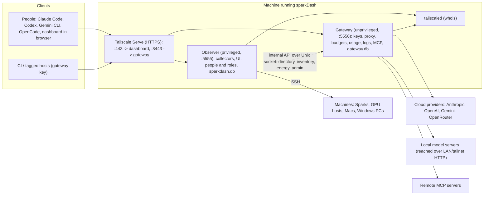

# Onyx sparkDash: AI Access Control Build Plan

Version: 2026-10-11 · Owner: Michael Gibbs (Onyx AI Labs)
Save this file as `docs/GATEWAY-PLAN.md` in the fork. It is the approved build plan.

## Overview

Onyx's build of sparkDash becomes an AI infrastructure platform for small and medium businesses. It keeps everything sparkDash observes today and adds self-hosted control of AI access: Tailscale Aperture's functions, running on your own hardware.

**Observe (exists, unchanged):** Sparks, Linux GPU hosts, Macs and Windows PCs; GPU, VRAM, CPU, RAM, disk, temperatures, network; local LLM servers and their metrics; health findings, energy, token totals, Activity.

**Control AI access (new):**

- One gateway URL for every AI tool. Provider keys are held centrally and encrypted; laptops hold none.
- Tailscale identifies every person. Gateway keys exist only for callers Tailscale can't identify, such as CI runners and tagged servers.
- People and roles in the dashboard: Owner, Admin, Member, Auditor.
- Grants (who can use which models) and budgets (per person, group or key).
- Usage and cost per person, including the energy cost of requests to local models, for one total AI spend figure.
- Request logging (off by default), retention, guardrails and an audit trail.
- MCP proxy with per-person tool access.

**Not in scope:** model routing, a chat UI, an agent that runs commands on machines, selling tokens.

## Architecture

Two services on the machine that runs sparkDash, released together from one repo. The Observer is today's sparkDash; the Gateway is new and is the only place provider keys exist.



| Service | Runs as | Owns |
| --- | --- | --- |
| **Observer** | Existing container: privileged, host network, host mounts | Collectors, dashboard UI and admin API (:5555), directory and roles, `config/sparkdash.db` |
| **Gateway** | New container: unprivileged, non-root, host network only | Identity checks, credentials, grants, budgets, proxy (:5556), usage, logs, guardrails, MCP, Connect page, `gateway-data/gateway.db` |

- The Observer calls the Gateway over a Unix socket; the Gateway never calls the Observer.
- The Observer sends three things: the directory (people and groups), the inventory of local model servers, and per-minute energy and token totals for local cost. All admin actions in the UI reach the Gateway through the same socket.
- The Gateway reaches model servers on other machines over LAN or tailnet HTTP. A server bound only to its own loopback on another machine can't be served; the Models tab flags it with the fix (bind to a LAN or tailnet address).
- Restarting the Observer doesn't interrupt agent traffic; heavy agent traffic doesn't slow the collectors.
- Health monitoring (GPU, VRAM, disk, temperatures, findings) stays entirely in the Observer. The Gateway does not use it.

## Identity and roles

One identity module (`shared/identity/`) serves both services. Tailscale names the person; sparkDash decides what they may do.

### Resolving who is calling

First match wins:

| Order | Method | Applies when |
| --- | --- | --- |
| 1 | Gateway key `sdgw_…` (Gateway only) | Key in `Authorization`, `x-api-key` or `X-SparkDash-Key` |
| 2 | Tailscale Serve headers | TCP peer is loopback and `Tailscale-User-Login` is present |
| 3 | `tailscaled` whois (LocalAPI socket) | Peer is a tailnet IP, or loopback with an `X-Forwarded-For` tailnet IP |
| 4 | Local console | Loopback peer, no Serve headers, no forwarded IP |
| — | Refused (`401`, names the fix) | Anything else, including loopback with a forwarded public IP (Funnel) |

Whois results are cached 60 seconds per IP and port. `SPARKDASH_TOKEN` remains for scripts and Prometheus and acts as Admin.

Other front doors (decided 2026-10-11, Michael):

- **Reverse proxy:** a loopback request whose `X-Forwarded-For` is not a tailnet IP is refused with a `401` that names the fix (Tailscale Serve, or send `SPARKDASH_TOKEN`). Existing reverse-proxy installs use the token; the CHANGELOG lists this as a breaking change and `docs/REMOTE-ACCESS.md` says a proxy must set `X-Forwarded-For`.
- **`SPARKDASH_LOCAL_CONSOLE=0`** turns off local-console Owner, for installs behind a proxy that does not set `X-Forwarded-For` (which would otherwise look like the local console). Default `1`.
- **SSH tunnel:** stays local console (Owner); anyone who can open one already has a shell on the host.
- **Not in Phase 1:** a trusted identity header from an identity-aware proxy (`Remote-User` style). Add later if a customer needs it.

### Roles

| Role | Can |
| --- | --- |
| **Owner** | Everything, including assigning roles and other Owners |
| **Admin** | Everything except managing Owners |
| **Auditor** | Read everything, including captured request content (each read is audited); change nothing |
| **Member** | Connect page, own usage, own personal gateway keys; no fleet pages |

- The local console has Owner rights, matching sparkDash's existing local trust.
- For remote-first installs, the Observer prints a one-time claim code (single use, valid 24 hours). The first person to enter it through Serve becomes Owner.
- A person seen for the first time gets the default role, Member, set in Settings.
- Tagged devices and gateway keys are never dashboard users.

### Directory

The Observer owns the directory: people (login, display name, role, first and last seen) and groups (a name plus logins, tags or keys). It pushes a snapshot to the Gateway whenever it changes. Every route in the existing dashboard API gets a minimum role; mutating routes require Admin.

## Credentials

A person pastes a key once, sees at once that it works, and never handles it again. These are requirements, not suggestions.

### Three kinds, named the same everywhere

| UI name | What it is | Held by |
| --- | --- | --- |
| **Provider key** | The Gateway's key to Anthropic, OpenAI, Gemini, OpenRouter or a local server | Gateway only, encrypted |
| **Gateway key** | A machine's key to the Gateway | CI runners, tagged servers, personal tools off the tailnet |
| **Own login** | A person's Claude or ChatGPT subscription, passed through | The person's laptop, as today |

The UI never says "token" for a credential (it means LLM tokens elsewhere), "virtual key", "BYOK" or "passthrough".

### Provider keys

Wireframe of the add-a-key flow (Models tab), three states left to right:

```text
1. Paste                      2. Test and save                  3. Saved, write-only
+--------------------------+  +------------------------------+  +----------------------------+
| Paste a provider key     |  | Detected: Anthropic          |  | Anthropic        [Working] |
| [ sk-ant-api03-…       ] |  | [ sk-ant-…a3F9             ] |  | sk-ant-…a3F9               |
| or pick a provider       |  | [      Test and save       ] |  | Added Oct 11 by mike       |
| [Anthropic] [OpenAI]     |->|  ● Works. 23 models available|->| Last used 2 min ago        |
| [Gemini]  [OpenRouter]   |  | If it fails, the fix is named|  | 23 of 23 models on         |
| Local models: switch on  |  |  Anthropic rejected this key |  | [Replace key] [Remove]     |
| below                    |  |  (401). Copy the whole key.  |  | Full key never shown again |
+--------------------------+  +------------------------------+  +----------------------------+
```

1. **Paste first.** One field, **Paste a provider key**, with provider tiles below. The prefix picks the provider (`sk-ant-` Anthropic, `sk-or-` OpenRouter, `AIza` Gemini, `sk-` OpenAI); anything else opens a picker.
2. **Test and save** is the only button. It lists models (a free call) and answers in place: "Works. 23 models available." A failure names the fix, with the raw error behind **Details**. Saving untested is allowed and shows **Not tested**.
3. **Write-only.** After saving, no screen or API returns the key. The card shows the last 4 characters, added by and when, last used, model count and status: **Working**, **Failing** (last error and time), **Not tested**, **Unused 30 days**.
4. **Replace key** tests the new key before discarding the old one.
5. **Remove** shows impact first: people, requests and models affected in the last 24 hours.
6. A failing key raises a health finding on the Overview.
7. A key may instead come from `GATEWAY_ANTHROPIC_API_KEY`, `GATEWAY_OPENAI_API_KEY` or `GATEWAY_GEMINI_API_KEY`; the card then reads **Set by environment variable**, with editing disabled.

Local model servers need no key step. Every server the Observer detects appears under **Local models** with a switch, **Serve through the gateway**. A server that already has an API key saved in sparkDash reuses it.

### Gateway keys

1. **New gateway key** asks for a name, what it may use (a group's access or a grant), and an expiry: 30 days, 90 days (default), 1 year, never.
2. The key is shown once, in a dialog that also holds a ready-to-paste setup block with the key filled in, each with **Copy**. The dialog closes only after **I've saved this key** is ticked.
3. Stored as a SHA-256 hash. The list shows name, prefix, creator, expiry, last used and device. **Revoke** applies to the next request.
4. A key expiring within 7 days shows a warning chip and an Activity event.
5. Members can create personal keys from the Connect page; these act as that person. Admins can turn this off.

### Own login

Anthropic and OpenAI provider cards have a switch: **Let people use their own Claude or ChatGPT subscription.** When on, a request carrying the person's own login is forwarded with it; usage is recorded and costed as **Subscription**, outside dollar budgets. When off, the client's login is stripped and the provider key is used.

## Gateway API and proxy rules

The Gateway serves three API formats, sends each request to the provider that serves the requested model, and changes nothing in transit except credentials.

### Endpoints (Gateway port, default 5556)

| Method and path | Purpose |
| --- | --- |
| `POST /v1/messages`, `POST /v1/messages/count_tokens` | Anthropic Messages |
| `POST /v1/chat/completions`, `/v1/responses`, `/v1/completions`, `/v1/embeddings` | OpenAI formats |
| `POST /v1beta/models/{model}:generateContent`, `:streamGenerateContent`, `:countTokens` | Gemini |
| `GET /v1/models` | Models the caller is granted, in OpenAI or Anthropic list shape |
| `HEAD /api/hello` | Claude Code warm-up probe; returns 200 |
| `POST /mcp`, `GET /mcp` | MCP proxy |
| `GET /me`, `/me/usage`; `GET/POST/DELETE /me/keys` | Connect page data, personal keys |
| `GET /` and assets | Connect page |

Bodies are read raw, up to 32 MB (`GATEWAY_MAX_BODY_MB`).

Outbound connections prefer IPv4 and allow 2 seconds per address (`dns.setDefaultResultOrder("ipv4first")`, `net.setDefaultAutoSelectFamilyAttemptTimeout(2000)`). Found in the spike: Sparks resolve providers' AAAA records with no IPv6 route, and Node 22's default 250 ms per-address attempt cancelled rin-den's ~300 ms IPv4 connect to Anthropic, so every `fetch` failed with `ETIMEDOUT`.

### Model resolution

A model name maps to exactly one enabled provider model. Local models are named `<machine>/<model>` (for example `spark-1/qwen3-coder`). A name matching more than one provider is a config error shown on the Models tab, never resolved silently. Unknown or ungranted models return `404` or `403` in the client's format.

### Forwarding rules

From Anthropic's gateway compatibility guide (https://code.claude.com/docs/en/llm-gateway-protocol), applied to every format:

- Forward every `anthropic-*` header and every body field unchanged. Never allowlist beta values.
- Stream event by event; never buffer; keep SSE `ping` events. No idle timeout on an open stream.
- Return upstream `retry-after`, `x-should-retry`, `anthropic-ratelimit-unified-*` and error bodies unmodified.
- Never redirect `/v1/models`.
- Strip hop-by-hop headers, `Host`, `Cookie`, `Tailscale-*`, `X-Forwarded-*`, `X-SparkDash-*`, and client auth headers unless own login applies.
- Set provider auth: `x-api-key` (Anthropic), `Authorization: Bearer` (OpenAI and compatible), `x-goog-api-key` (Gemini).
- Read `x-claude-code-session-id` and `x-claude-code-agent-id` for usage; don't forward them.
- One exception to "unchanged": streamed Chat Completions get `stream_options.include_usage: true` when the client didn't ask, and the extra usage chunk is removed before the client sees it. A provider switch disables this.

### Placeholder credential

On the tailnet, clients that insist on a key use the literal `sparkdash`. The Gateway treats it as no credential and uses Tailscale identity.

## Client setup and the Connect page

A person opens one URL on the tailnet, picks their tool, copies one block, and watches their first request arrive.

### Publishing the URL

The Gateway binds `127.0.0.1:5556`. **Publish on your tailnet** (AI Gateway page) runs `tailscale serve --bg --https=8443 http://127.0.0.1:5556` through the host namespace, as the Tailnet probe already does for `tailscale status`, and shows the resulting `https://<machine>.<tailnet>.ts.net:8443`. If it lacks permission, it shows the command with **Copy**. HTTPS via Serve also meets Claude Desktop's trusted-certificate requirement.

### Connect page (`/` on the Gateway)

1. Banner: who you are, your device, how many models you can use, your budget used this period.
2. Tool tiles: Claude Code, Claude Desktop, Codex, Gemini CLI, OpenCode, Other (OpenAI-compatible), CI, MCP.
3. For the chosen tool: **Use my own subscription** or **Use the company's key** where it applies, an OS tab, one copy block, and a `curl` check.
4. Live line: "Waiting for your first request…", then "Connected: Claude Code, claude-sonnet-4-6, 3 seconds ago" (client recognised from `User-Agent`).
5. My usage and, if allowed, personal gateway keys.

### Snippets

URL and model names are filled in live. Each must be verified in the spike.

| Tool | Configuration |
| --- | --- |
| Claude Code, own subscription | `ANTHROPIC_BASE_URL` in the `env` block of `~/.claude/settings.json` |
| Claude Code, company key | `ANTHROPIC_BASE_URL` + `ANTHROPIC_AUTH_TOKEN=sparkdash` (https://code.claude.com/docs/en/llm-gateway-connect) |
| Claude Desktop | Developer → Configure Third-Party Inference → gateway URL |
| Codex | `~/.codex/config.toml`: `model_provider = "sparkdash"`, `[model_providers.sparkdash]` with `base_url`, `env_key`, `wire_api = "responses"` (https://learn.chatgpt.com/docs/config-file/config-advanced.md) |
| Gemini CLI | `GOOGLE_GEMINI_BASE_URL`, `GEMINI_API_KEY=sparkdash` |
| OpenCode and other OpenAI-compatible | Base URL `https://…:8443/v1`, key `sparkdash` |
| CI (GitHub Actions) | `ANTHROPIC_BASE_URL` in `env`; gateway key as `anthropic_api_key` (sent as `x-api-key`); runner joins the tailnet |
| MCP (Claude Code) | `claude mcp add --transport http sparkdash https://…:8443/mcp` |

Optional for Claude Code: `CLAUDE_CODE_ENABLE_GATEWAY_MODEL_DISCOVERY=1` lists the Gateway's Claude models in `/model`.

## Access, usage, cost and budgets

Grants decide which models a caller may use, every response is metered from the provider's own token counts, and budgets are checked before a request is sent.

### Grants

- A grant has selectors (`*`, a login, `group:<name>`, `tag:<name>`, `key:<name>`, `local`), model patterns (`claude-*`, `spark-1/*`) and MCP tool patterns (`github__*`).
- Access is the union of matching grants. Enabling the Gateway creates **Everyone → all models**.
- A denied request gets `403` naming the model and the access needed.

### Token counts

The response streams to the client first; a tap parses a copy.

| Format | Non-streaming | Streaming |
| --- | --- | --- |
| Anthropic | `usage.input_tokens`, `output_tokens`, `cache_read_input_tokens`, `cache_creation_input_tokens` | `message_start` (input, cache), last `message_delta` (output) |
| OpenAI Chat | `usage.prompt_tokens`, `completion_tokens`, `prompt_tokens_details.cached_tokens` | Final usage chunk (`include_usage`) |
| OpenAI Responses | `usage.input_tokens`, `output_tokens`, `input_tokens_details.cached_tokens` | `response.completed` → `response.usage` |
| Gemini | `usageMetadata.promptTokenCount`, `candidatesTokenCount`, `cachedContentTokenCount`, `thoughtsTokenCount` | Last chunk's `usageMetadata` |

A stream that ends before usage arrives is stored with the counts known so far, marked **partial**.

### Cost

| Request type | Cost |
| --- | --- |
| Cloud, company key | Tokens × the model's price (per million: input, output, cache read, cache write) |
| Own login | Shown as **Subscription**; no dollar cost |
| Local model | Share of the machine's measured energy × electricity rate |

- No built-in price list. A model without a price shows **No price set** with an inline field. Each request stores the price it was charged at.
- **Local energy cost.** Each minute, the Observer sends the Gateway each machine's energy (Wh) and each local server's total tokens processed, both from data it already collects, plus the electricity rate from Energy settings. The Gateway splits that minute's cost across its requests on that server by token share. Tokens not seen by the Gateway (direct use) and idle minutes stay **unattributed** and are shown as such. Local costs settle within about 2 minutes and are labelled as estimates.

### Budgets

- Scope: everyone, person, group or gateway key. Period: day, week or month, in the Settings time zone. Limit: USD or tokens. Warning at 80% by default.
- Before forwarding, the Gateway adds the period's spend (rollup) to in-flight reservations (each in-flight request reserves its `max_tokens`, or 4,096 if absent, at output price). At most 8 in-flight requests per identity.
- Exhausted: `429` in the client's format with `x-should-retry: false` and a message naming the budget and reset time, such as "Budget 'Mike monthly' used: $50.00 of $50.00. Resets Nov 1."
- Subscription requests count toward token budgets only.
- Warning and exhaustion write Activity events and show on the Connect page.

### Usage views

Group by person, group, model, provider, client tool or Claude Code session; ranges match Token totals (24 hours, 7 days, 30 days, all). Gateway traffic to local models also feeds Token totals.

## Logging, guardrails and audit

Metadata is always recorded; prompt and response content only when an Admin turns capture on. Every read of captured content is audited.

### Capture

| Mode | Stored | Default retention |
| --- | --- | --- |
| **Metadata only** (default) | Time, identity, device, client, provider, model, format, status, latency, time to first byte, tokens, cost, guardrail hits, session and agent IDs | 400 days |
| **Full capture** | Metadata plus request and response bodies, gzip, capped at 2 MB each | 7 days for bodies |

- In metadata-only mode, bodies are never written to disk.
- An hourly job purges bodies and metadata past retention.
- Switching to full capture shows: "Everyone's prompts and responses will be stored on this machine for 7 days. Admins and Auditors can read them; each read is logged."
- Stored headers are allowlisted: `User-Agent`, `anthropic-version`, `anthropic-beta`, Claude Code session and agent IDs. Auth headers are never stored.
- Export: JSONL of metadata for a chosen range.

### Guardrails

Run before the request leaves the machine. Each detector is **Off**, **Flag** (record only), **Redact** (stable placeholder such as `[EMAIL_1]`) or **Block** (`400` naming the detector, never the matched text).

- Built-in detectors: email, phone, payment card (Luhn), US SSN, Canadian SIN (Luhn), secrets (AWS keys, GitHub and Slack tokens, private key blocks, `sk-` keys). Admins add regex detectors.
- Scanned: message and system text, tool results. Skipped: thinking blocks and signatures, encrypted reasoning, base64 media, IDs, model names, tool schemas.
- Redaction is deterministic within a conversation, so each turn's history matches the last; the UI notes it may affect Claude's extended thinking and recommends Flag or Block for coding agents.
- Tool blocking: listed tool names (patterns allowed) are removed from requests. The spike found no provider rejects a conversation after a tool is removed, so removal is used everywhere. Gemini 3.x function-call parts carry a `thought_signature` that must reach the provider unchanged (a missing one is a `400`); the scanner never edits those parts.
- Hook: optional pre-request webhook returning `allow`, `block` with a message, or `replace` with a new body; 2-second timeout, fail-open or fail-closed; warns when the URL is outside loopback, LAN or tailnet.

### Audit

Written to Activity and to the audit table: captured content viewed (by whom, which request); changes to roles, grants, budgets, providers, keys, capture and guardrails; budgets exhausted; keys revoked.

## MCP proxy

One endpoint, `/mcp`, combines the tools of every remote MCP server an Admin adds; each person sees only the tools their grants allow, and upstream credentials stay in the Gateway.

- **Transport:** Streamable HTTP. The Gateway answers `initialize`, `ping`, `tools/list`, `tools/call`; returns `202` for notifications and `405` for `GET /mcp`. Upstream JSON and SSE replies are both parsed.
- **Naming:** tools are listed as `<server>__<tool>` (`github__create_issue`); the prefix is stripped upstream.
- **Grants:** tool patterns in grants. Ungranted tools are absent from `tools/list`; calling one returns a JSON-RPC error naming the access needed.
- **Sessions:** one upstream session per server via `Mcp-Session-Id`, re-initialised once on expiry.
- **Adding a server:** URL plus optional header (usually `Authorization: Bearer …`), then **Test and save**, which runs `initialize` and `tools/list` and shows "Connected. 18 tools." Header values are write-only and encrypted. One shared credential per server.
- **Logging:** each `tools/call` is a request record (person, server, tool, latency, status); arguments and results only under full capture.
- **Not included:** stdio servers, resources, prompts, sampling, server-initiated messages, per-person upstream OAuth.

## Data model

Each service owns one SQLite database (WAL mode, `better-sqlite3`, versioned migrations). The Gateway's data lives on a volume the Observer does not mount.

### Storage

| Path | Owner | Contents |
| --- | --- | --- |
| `config/sparkdash.db` | Observer | Directory, claim codes, Observer audit |
| `gateway-data/gateway.db` | Gateway | AI policy, credentials (encrypted), requests, usage, audit |
| `gateway-data/secrets.key` | Gateway | AES-256-GCM key (or `GATEWAY_SECRETS_KEY`) |
| `gateway-data/bodies/<id>.json.gz` | Gateway | Captured content, full capture only |
| `ipc/gateway.sock`, `ipc/internal.secret` | Gateway creates; Observer reads | Internal API socket and its shared secret (0600) |

### Observer tables

- `people` (id, login, display_name, role, first_seen, last_seen)
- `groups` (id, name), `group_members` (group_id, selector)
- `claim_codes` (hash, expires_at, used_at)
- `audit` (id, ts, actor, action, target, detail)

### Gateway tables

- `directory` (snapshot of people and groups pushed by the Observer)
- `providers` (id, type, name, base_url, options, own_login, status, last_error, last_tested_at, key_last4, key_source), `provider_secrets` (provider_id, ciphertext)
- `models` (id, provider_id, name, enabled, price_in, price_out, price_cache_read, price_cache_write)
- `local_servers` (inventory pushed by the Observer: machine, address, port, backend, models, api_key ciphertext, up)
- `grants` (id, name, selectors, model_patterns, mcp_patterns, updated_by, updated_at)
- `budgets` (id, name, scope, period, limit_usd, limit_tokens, warn_pct)
- `gateway_keys` (id, name, prefix, hash, acts_as, access, created_by, created_at, expires_at, last_used_at, last_used_from, revoked_at)
- `requests` (id, ts, identity, via, device, client, provider_id, model, format, stream, status, latency_ms, ttfb_ms, in_tok, out_tok, cache_read_tok, cache_write_tok, cost_usd, cost_basis, price_snapshot, partial, session_id, agent_id, guardrail_hits, error, body_path)
- `usage_daily` (day, identity, model, provider_id, requests, tokens by type, cost_usd)
- `energy_minutes` (machine, minute, wh, rate, server_tokens)
- `detectors`, `hooks`, `settings`
- `mcp_servers` (id, name, url, status, tool_count), `mcp_secrets` (server_id, ciphertext)
- `audit` (id, ts, actor, action, target, detail)

### Internal API (Observer → Gateway, over the socket)

| Call | Purpose |
| --- | --- |
| `PUT /internal/directory` | People and groups snapshot, on change |
| `PUT /internal/inventory` | Local model servers, on change |
| `POST /internal/energy` | Last minute's energy, server tokens and rate per machine |
| `/internal/admin/*` | All admin reads and writes, with the acting person in `X-SparkDash-Actor` |
| `GET /internal/events?since=` | Gateway audit events for Activity |
| `GET /internal/health` | Gateway status for the dashboard |

The Gateway never calls the Observer.

## UI changes

Two new pages, **People** and **AI Gateway**, built from sparkDash's existing panels, tables, charts and Clear menus. What a person sees depends on their role.

### By role

- **Owner, Admin, Auditor:** all existing pages plus People and AI Gateway. Auditors see everything read-only.
- **Member:** opening the dashboard sends them to the Connect page. They never see fleet pages.
- The header shows the signed-in person and role, with a **Switch to Connect page** link.

### People (`/people`)

A row per person seen: name, login, role (dropdown), groups, models they can use, budget bar, last request, last device. Groups are edited in a side panel. Settings gains **Default role for new people** and **Create claim code**.

### AI Gateway (`/gateway`)

Before first use, one card with three steps that tick off when done:

1. **Turn on the gateway.** Starts the Gateway and creates the default grant.
2. **Add a model source.** The paste-a-key field, plus detected local servers with their switches.
3. **Publish and share.** **Publish on your tailnet**, then the Connect page URL with **Copy link**.

Budgets, guardrails and capture keep their defaults (none, off, metadata only) until changed. After setup, seven tabs:

| Tab | Shows | Actions |
| --- | --- | --- |
| Overview | Status, URL, requests and spend today, top people and models, findings | Publish, pause, open Connect page |
| Models | Provider cards, local servers, models with prices and switches | Paste key, Test, Replace, Remove, set prices |
| Access | Grants, budgets, gateway keys | New grant (previews who gains or loses access), New budget, New key, Revoke |
| Usage | Chart and tables by person, group, model, provider, client or session; local energy cost and unattributed | Range, group by, CSV |
| Requests | Request log with filters | Open request; view content (audited) |
| Privacy and guardrails | Capture mode, retention, detectors, tool blocking, hook | Change, test a detector on sample text |
| MCP | Servers, tool counts, status | Add, Test, Remove |

### Elsewhere

- Sidebar: People and AI Gateway under Token totals; the Gateway item carries a status dot.
- Mobile: both join the Stats tab.
- Command palette: Go to AI Gateway, Go to People, Add provider key, New gateway key, Copy Connect link.
- Health findings: provider key failing, budget past warning, gateway key expiring within 7 days, Gateway down.
- Activity: Gateway audit events appear alongside fleet events.

Errors say what happened and the fix in one line. Empty states name the next action in one sentence.

## Security requirements

Each row is a requirement with a test in the phase that builds it.

| Threat | Requirement |
| --- | --- |
| Gateway reachable from the internet | Binds `127.0.0.1` by default. `GATEWAY_BIND_HOST` accepts tailnet (100.64.0.0/10) or private addresses; a public address needs `GATEWAY_ALLOW_PUBLIC_BIND=1` and logs a warning each start |
| Funnel exposure | Loopback request with a forwarded public IP is refused. Overview finding if `tailscale serve status` shows the Gateway on Funnel |
| A web page in a user's browser spending as them | Model, MCP and `/me` endpoints refuse cross-origin `Origin` headers and never answer CORS preflights |
| Spoofed Serve headers | Trusted only when the TCP peer is loopback and the listener is loopback-bound |
| Provider key exposure | Write-only API; encrypted at rest; never logged; shared redaction helper masks key shapes in all log output; a test greps every output for a planted key |
| Gateway key theft | Shown once; SHA-256 hashes only; expiry by default; last-used device shown; revocation on next request |
| Content exposure | Capture off by default; body files 0600; retention purge; every read audited |
| Budget bypass by parallel requests | In-flight reservations; at most 8 in-flight per identity |
| Runaway clients | Per-identity request rate limit; 32 MB body cap; connect and first-byte timeouts |
| SSRF via admin-set URLs | Provider, MCP and hook URLs: http/https only; link-local and cloud metadata ranges refused; no credentialed redirects |
| Dashboard misuse | Every dashboard route has a minimum role; mutating routes need Admin |

### Container hardening

- **Gateway:** non-root user, no `privileged`, no `pid: host`, no host filesystem mounts, read-only root filesystem, all capabilities dropped. Mounts only `gateway-data`, `ipc` and the host's `tailscaled.sock` (read-only). Host networking, so it can reach model servers bound to the host's loopback.
- **Observer:** unchanged (privileged, needed for collectors).
- The split keeps provider keys out of the Observer's process and its large API surface. It does not protect against root on the host.

## Build phases

Five phases, in order. Each ends with its acceptance criteria met, tests green (`npm test`, `npm run typecheck`) and existing behaviour unchanged.

### Phase 1: People and roles

- [x] Add `better-sqlite3`, `config/sparkdash.db`, migration runner
- [x] `shared/identity/`: Serve headers, whois via LocalAPI socket (CLI fallback), local console, refusal rules, 60-second cache
- [x] Directory: people, groups, roles; default role; claim codes
- [x] Minimum role on every existing dashboard route; WebSocket upgrade checks role
- [x] People page; signed-in header; Settings additions
- [x] Member redirect placeholder (Connect page arrives in Phase 2)
- [x] Tests: each resolution path, Funnel refusal, role matrix for every route, claim code single use and expiry

**Done when:** a teammate opening the dashboard through Serve is a Member and sees no fleet pages; an Owner promotes them to Admin and they see everything; the local console still has full access.

### Phase 2: Gateway core

- [x] `gateway/` service, second Compose service with the hardening above, `gateway-data` and `ipc` volumes
- [x] Internal API over the socket; directory and inventory push from the Observer
- [x] Provider keys: detect, Test and save, write-only, replace, remove with impact, environment-variable keys
- [x] Local servers from inventory with **Serve through the gateway**
- [x] Proxy: Anthropic, OpenAI (Chat, Responses, Completions, Embeddings), Gemini; `/v1/models`; `/api/hello`; own login; forwarding rules
- [x] Gateway keys: create (reveal once with snippet), list, revoke, expiry warning
- [x] Default grant; grant check (editor comes in Phase 3)
- [x] Connect page with snippets and live first-request line; Publish on your tailnet
- [x] AI Gateway page: first-run card, Overview and Models tabs
- [x] Tests: fake upstreams for each format (recorded SSE with pings, errors, mid-stream drop); byte-identical streaming; header policy; no-secret grep; encryption round trip

**Done when:** Claude Code (own subscription and company key, with extended thinking, a subagent and `/compact`), Codex, Gemini CLI and OpenCode against a local model all work through the Gateway; added time to first byte is under 5 ms.

Acceptance on rin-den (2026-10-12), Gateway container as in docker-compose.yml (uid 1000, read-only, no capabilities), env provider keys, published with Tailscale Serve on :8443, clients run from a Mac on the tailnet with the Connect page's own snippets:

- [x] Claude Code 2.1.296, company key (`ANTHROPIC_AUTH_TOKEN=sparkdash` in settings.json): plain reply, extended thinking (thinking blocks returned), a subagent (its requests carry their own agent ID) and `/compact`. All requests 200, identified by Tailscale as the person and device.
- [x] Claude Code, own subscription (2026-10-13): signed in to a Claude subscription, `ANTHROPIC_BASE_URL` only; the person's login was forwarded, the company key not used. Logged as claude-opus-5-5, 200, cost basis subscription.
- [x] Codex 0.162.1 (Responses API), Gemini CLI 0.63.0 (native Gemini) and OpenCode 1.19.0 (Chat Completions) all answered. OpenCode with `gpt-5-mini` gets OpenAI's own 400 (`max_tokens` unsupported; the Gateway passes bodies unchanged), so cloud models for OpenCode need one that accepts `max_tokens`, such as `gpt-4.1-mini`.
- [x] OpenCode against a local model: `iris-den/GLM-5.3-Flash-EXL3` (GLM 5.3 Flash on EXL3 across iris-den and nyx-den, served from iris-den:8888) through **Serve through the gateway**; the Gateway rewrote the model name for the server, two requests, both 200, cost basis local.
- [x] Added time to first byte: **0.73 ms p50, 1.19 ms p90** on the Spark against a local upstream (`gateway/bench/overhead.mjs`, 300 requests). Against Anthropic itself the difference is lost in its ±60 ms jitter: direct p50 595 ms, through the Gateway 591 ms.
- Note: a Claude Code process that already has `ANTHROPIC_BASE_URL` in its environment (for example one started from another Claude tool) ignores the settings.json `env` block. The Connect page's snippet is right for a normal terminal.

### Phase 3: Usage, cost and budgets

- [ ] Usage taps for all four formats, including partial streams and the hidden `include_usage` chunk
- [ ] Prices table; price snapshot per request; Subscription marking
- [ ] Energy push from the Observer; per-minute local cost allocation; unattributed totals
- [ ] Rollups; budgets with in-flight reservations and per-identity concurrency cap; client-format `429`
- [ ] Grants and groups editors; Access and Usage tabs; Token totals feed
- [ ] Tests: parser tables per format; budget period boundaries in America/Toronto; overshoot bound with 8 parallel requests; allocation maths

**Done when:** a test session's tokens match the provider console; a budget stops Claude Code and Codex with a readable message and no retry loop; a local request shows an energy cost within 2 minutes.

### Phase 4: Logging, guardrails and audit

- [ ] Capture modes, body store, retention purge, JSONL export
- [ ] Requests tab; audited content view; Activity merge of Gateway audit
- [ ] Detectors, scanner, deterministic redaction, tool blocking, hook
- [ ] Privacy and guardrails tab with detector test box
- [ ] Tests: metadata-only writes no body files; purge with a fake clock; detector true and false positives; thinking blocks untouched

**Done when:** viewing captured content writes an audit event naming the viewer; a planted card number is blocked or redacted as configured without breaking a Claude Code session.

### Phase 5: MCP proxy

- [ ] Upstream client (JSON and SSE), sessions, aggregation, prefixing, grant filtering
- [ ] MCP tab with Test and save; Connect page MCP tile
- [ ] Tests: fake MCP server; grant filtering; session expiry

**Done when:** in Claude Code, two people with different grants see different tool lists from the same endpoint, and calls are logged.

## Spike: verify before building

Answer these on a real Spark and tailnet at the start of Phase 1, and record each result in this file. A "no" changes the noted part of the plan.

- [x] Does Tailscale Serve set `X-Forwarded-For` to the caller's tailnet IP? If no, tagged devices use gateway keys only.
  **Yes.** Request from mike-den to `https://rin-den…:8443` arrived from TCP peer `127.0.0.1` with `X-Forwarded-For: 100.65.30.25` (mike-den), plus `Tailscale-User-Login`, `Tailscale-User-Name`, `Tailscale-User-Profile-Pic`, `Tailscale-Headers-Info`, `X-Forwarded-Host`, `X-Forwarded-Proto: https`. Not yet tested from a tagged device (the tailnet has none); whois covers that path.
- [x] Can a non-root process with the host's `tailscaled.sock` mounted read-only call LocalAPI whois? If no, give the Gateway's user Tailscale operator rights (`tailscale set --operator`).
  **Yes.** Container as uid 65534, `--read-only`, `--cap-drop ALL`, socket mounted `:ro`: `GET /localapi/v0/whois?addr=100.65.30.25:1` returned 200 with `UserProfile.LoginName` and `Node.Name`. Depends on the host socket's default mode 0666; the Gateway's health check reports it if a host has tightened it.
- [x] Can the Observer run `tailscale serve` through the host namespace? If no, Publish shows the command to copy.
  **Yes.** From a privileged, `pid: host` container, `nsenter --mount=/host/proc/1/ns/mnt -- tailscale serve --bg --https=8444 …` published, `serve status` listed it as "(tailnet only)", and `--https=8444 off` removed it. Same mechanism as the existing `TailscaleProbe`.
- [x] Does `better-sqlite3` build and run in the arm64 image?
  **Yes.** `better-sqlite3@12.11.1` installs from its prebuilt binary in the existing Dockerfile (no Dockerfile change); in the built image, as uid 65534 with `--read-only`, it opened a file in WAL mode and wrote and read a row (SQLite 3.53.2, arm64). Add it with a normal `npm install`: `npm i --package-lock-only` drops other platforms' optional bindings (npm/cli#4828) and breaks the Tailwind build.
- [x] Exact base URLs and key handling for Codex, OpenCode and Gemini CLI at their current versions.
  Captured against a local recorder on 2026-10-11:
  - **Codex 0.162.1:** `base_url` must include `/v1`; sends `POST /v1/responses` with `Authorization: Bearer <env_key value>`. Session and turn IDs arrive in the `x-codex-turn-metadata` JSON header (use for the session view). Snippet adds `request_max_retries = 0` only for testing; omit in the published snippet.
  - **OpenCode 1.19.0:** provider block in `~/.config/opencode/opencode.json` with `"npm": "@ai-sdk/openai-compatible"`, `options.baseURL` = `https://…:8443/v1`, `options.apiKey` = `sparkdash`; sends `POST /v1/chat/completions` with `Authorization: Bearer`, plus `x-opencode-session-id`.
  - **Gemini CLI 0.63.0:** `GOOGLE_GEMINI_BASE_URL` is the bare origin (no `/v1beta`); sends `x-goog-api-key`; calls `…:generateContent` and `…:streamGenerateContent?alt=sse` (query string must be forwarded). Headless use also needs `~/.gemini/settings.json` `{"security":{"auth":{"selectedType":"gemini-api-key"}}}`, or it exits with "Invalid auth method selected". It also calls a utility model (`gemini-3.5-flash-lite`) besides the chosen one, so grants for Gemini users must cover it or the CLI fails.
- [x] Which providers reject a conversation after a tool definition is removed (decides strip versus block per provider).
  **None.** History containing a call to `get_weather` and its result, then the next turn sent with the tool present, replaced by another tool, or with no tools at all: every case returned 200 on Anthropic Messages (claude-haiku-5-5), OpenAI Chat Completions and Responses (gpt-5-mini), and Gemini (gemini-3.5-flash-lite). Strip everywhere. Gemini 3.x needs the model's own `thought_signature` on replayed function calls; a hand-built call without one is a `400` in every case, so the Gateway and guardrails must leave those parts untouched. Script: `sparkDash-tools/spike/tool-removal.mjs`.
- [x] Baseline time to first byte for Claude Code direct to Anthropic, for the Phase 2 comparison.
  Measured at the API level from the Gateway's host (rin-den), which is what the "under 5 ms added" target compares against: 20 streaming `/v1/messages` requests to claude-haiku-5-5 over a kept-alive connection, response headers and first SSE bytes both at **min 531, p50 605, p90 651, max 664 ms** (2026-10-12). Phase 2 repeats the same script through the Gateway on the same host. A Claude Code end-to-end comparison runs in Phase 2's acceptance checks. Script: `sparkDash-tools/spike/ttfb-baseline.mjs`.

## Repo and working rules

New code lives in new folders; upstream files get small, wiring-only changes, so each of Mia's releases merges cleanly.

### Layout

| Path | Contents |
| --- | --- |
| `gateway/` | Gateway service: `index.js`, `app.js`, `proxy/`, `providers/`, `usage/`, `policy/` (grants, budgets), `credentials/`, `guardrails/`, `mcp/`, `store/` (DB, migrations), `internal/` |
| `shared/` | `identity/`, `crypto.js` (AES-GCM helpers moved out of `secretsStore.js`), `redact.js`, `sqlite.js` (migration runner) |
| `server/access/` | Observer directory, roles, route guards, claim codes |
| `server/gatewayBridge/` | Observer side of the internal API: pushes, admin proxy, event import |
| `src/components/PeoplePage/`, `src/components/GatewayPage/` | New dashboard pages |
| `src/connect/` | Connect page (separate Vite entry, served by the Gateway) |

Upstream files touched (wiring only): `server/index.js`, `server/auth.js`, `server/secretsStore.js`, `src/App.tsx`, `src/constants.ts`, sidebar, mobile tab bar, command palette, `docker-compose.yml`, `Dockerfile`, `package.json`, `README.md`, `CHANGELOG.md`, `NOTICE`.

### Rules

- Fork: `MikeGibbsOnyx/sparkDash`. Integration branch `onyx/main`; one branch per phase (`onyx/p1-people`, `onyx/p2-gateway`, …) merged into it when the phase is done.
- Upstream: an `upstream` remote; merge each sparkDash release into `onyx/main` promptly. Fixes and features useful at any scale go upstream as separate small PRs. Before anything merges into upstream main, check with Mia as a courtesy.
- Conventions: plain JS ESM on the server, `node:test`, React 19 + TypeScript + Tailwind v4, `atomicWrite` for JSON state, Activity through `recordEvent`.
- Licence: keep `LICENSE` and `NOTICE`; add an Onyx line to `NOTICE`; mark modified upstream files.
- Every phase updates the README, CHANGELOG and tests for what it adds.

## Sources

- Aperture docs: https://tailscale.com/docs/aperture
- Aperture supported providers and clients: https://tailscale.com/docs/aperture/reference/supported-providers-clients
- Aperture privacy and data retention: https://tailscale.com/docs/aperture/privacy-and-data-retention
- Tailscale Serve identity headers: https://tailscale.com/kb/1312/serve
- Claude Code, connect to an LLM gateway: https://code.claude.com/docs/en/llm-gateway-connect
- Claude Code gateway compatibility guide: https://code.claude.com/docs/en/llm-gateway-protocol
- Codex advanced configuration: https://learn.chatgpt.com/docs/config-file/config-advanced.md
- sparkDash repository (v2.40.0): https://github.com/MiaAI-Lab/sparkDash

